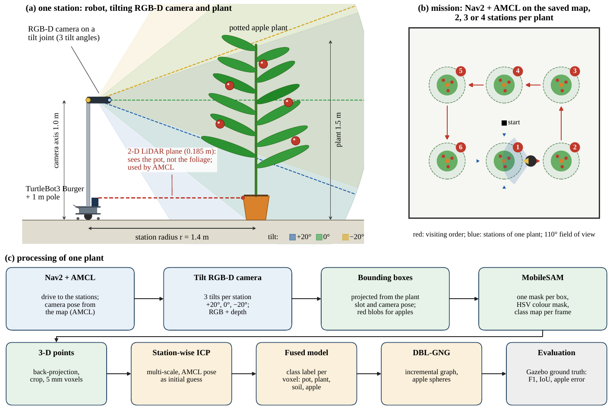
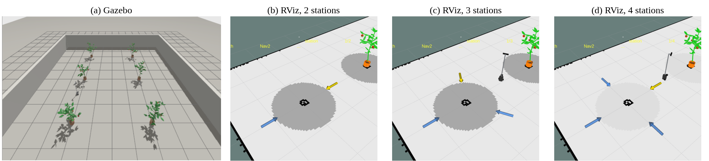
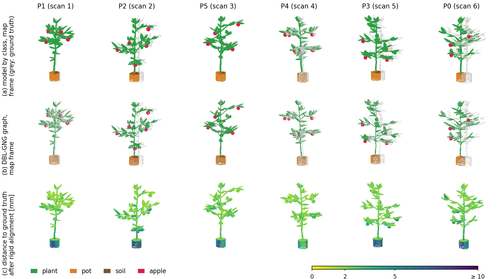

# Multi-viewpoint plant reconstruction with a mobile robot

A TurtleBot3 drives to scan stations around potted fruit plants in a Gazebo arena, takes RGB-D frames with a tilting
camera, segments them with MobileSAM, builds a 3-D model of every plant and learns a DBL-GNG graph on it. The robot
localises itself with **Nav2 + AMCL** on a saved 2-D map, and the camera pose used for the reconstruction is that map
pose (no ground truth is used by the pipeline). Everything runs live in **Gazebo Fortress + RViz** on ROS 2 Humble.

<p align="center"></p>

The number of **viewpoints** (stations on a circle around each plant) is the experimental variable:

| Viewpoints | Station azimuths | Views per plant |
|---|---|---|
| 2 | `0,180` | 6 |
| 3 | `0,120,240` | 9 |
| 4 | `0,90,180,270` | 12 |

Each station is visited with the camera tilted to +20°, 0° and −20°, which gives three views per station.

## Quick start

Full instructions, including installation and troubleshooting, are in **[docs/TUTORIAL.md](docs/TUTORIAL.md)**.

```bash
# 1. Get the code (the scripts expect the workspace at ~/plant_ws)
git clone https://github.com/yani-rl-ai/plant-recon-viewpoints.git ~/plant_ws
cd ~/plant_ws

# 2. Build (needs ROS 2 Humble + Gazebo Fortress, see the tutorial) and fetch the MobileSAM weights into ~/plant_ws/models/
source /opt/ros/humble/setup.bash
colcon build --symlink-install --packages-select plant_sim

# 3. In every terminal you use for this project
source ~/plant_ws/env.sh

# 4. The robot visits the stations of all plants (order 1, 2, 5, 4, 3, 0), takes the images and builds the DBL-GNG models;
#    Gazebo and RViz open and show everything live.

# 2 viewpoints
ros2 launch plant_sim scan.launch.py plants:=1,2,5,4,3,0 pose_source:=map use_yolo:=false localizer:=amcl azimuths:=0,180

# 3 viewpoints
ros2 launch plant_sim scan.launch.py plants:=1,2,5,4,3,0 pose_source:=map use_yolo:=false localizer:=amcl azimuths:=0,120,240

# 4 viewpoints
ros2 launch plant_sim scan.launch.py plants:=1,2,5,4,3,0 pose_source:=map use_yolo:=false localizer:=amcl azimuths:=0,90,180,270
```

Always pass `pose_source:=map`. The default (`odom`) uses wheel odometry only, which drifts by more than 1 m over the
six plants. Results are written to `~/plant_ws/results/scan_<date>_<time>/`. Stop everything with `~/plant_ws/stop_sim.sh`.

## What you see

Gazebo shows the robot driving around the plants; RViz shows the 2-D map, the keep-out zones, the scan stations
(yellow arrow = current target, blue = the others), the growing class-coloured model, the DBL-GNG graph, the apple
estimates and the MobileSAM class map of the current frame.

<p align="center"></p>

## Reference results

One mission per layout, six plants, 28 apples, on the machine described in the tutorial (simulation, noise-free depth).
The camera pose is the AMCL pose; the median AMCL position error over all views was 80, 83 and 68 mm.

| Viewpoints | Mission time | Median time per plant | F1 @ 2 cm, aligned frame | Recall @ 2 cm, aligned | F1 @ 2 cm, map frame | Apples within 5 cm, aligned / map frame |
|---|---|---|---|---|---|---|
| 2 | 10.3 min | 105 s | 0.979 | 0.958 | 0.32 | 28 / 3 |
| 3 | 14.7 min | 148 s | 0.993 | 0.987 | 0.34 | 28 / 5 |
| 4 | 21.4 min | 190 s | 0.996 | 0.993 | 0.38 | 28 / 11 |

How to read this:

* The **aligned frame** is the model after the best rigid alignment to the true surface. It measures the shape of the
  reconstruction independent of its placement. The alignment needs the ground truth, so a real robot cannot do it.
* The **map frame** is the frame in which the model was built. It contains the error of the camera pose, so it is
  what a deployed robot would get. There the F1 is set by the AMCL pose error, not by the number of viewpoints.
* The apple results of 28 / 28 are in the aligned frame, and that alignment includes the apples. In the map frame
  most apple centres are further than 5 cm from the true ones.
* Every number comes from a single mission per layout in simulation, so differences between the layouts are not
  tested statistically.

<p align="center"></p>

## Repository layout

```
env.sh, stop_sim.sh        per-terminal environment (ROS domain 42, loopback only, own Gazebo partition) and a safe "stop everything"
src/plant_sim/             ROS 2 package: Gazebo world, robot model, Nav2/AMCL configuration, launch files, scan manager
  launch/                  sim.launch.py (world + robot), nav.launch.py (+ Nav2 + AMCL), scan.launch.py (+ scan manager + RViz),
                           mapping.launch.py (SLAM Toolbox, only needed to re-make the map)
  scripts/                 scan_manager.py (stations, tilts, reconstruction), nav_helpers.py, teleop_keyboard.py,
                           check_*.py (self-tests), gen_world.py (world + ground-truth generator)
  config/                  nav2_params.yaml, RViz configurations
  maps/                    saved 2-D occupancy map of the arena (plant_arena.pgm/.yaml)
  gt/                      exact ground-truth surface points of the plants (plants_gt.npz) and fruit centres (plants.json)
src/plant_recon/           plain Python package (not a colcon package): segmentation, point clouds, ICP, DBL-GNG, metrics
docs/                      TUTORIAL.md, MAPPING.md, images
```

## Documentation

* [docs/TUTORIAL.md](docs/TUTORIAL.md): installation, building, running the 2-, 3- and 4-viewpoint missions, reading
  the output, parameters and troubleshooting.
* [docs/MAPPING.md](docs/MAPPING.md): re-making the 2-D map (only needed if you change the world).

## Limitations

* Simulation only. The depth images have no noise model, and the six plants are all of one procedurally generated type.
* The plant positions (slots) are known from the field layout and are used to place the MobileSAM bounding boxes.
* MobileSAM runs on a CUDA GPU as shipped (see the tutorial for the CPU change).
* The HSV colour thresholds are tuned for the simulated colours.
* Not tested on a real robot.

## Third-party components and references

* **DBL-GNG**: C. Z. Siow, A. A. Saputra, T. Obo, N. Kubota, "Distributed batch learning of growing neural gas for quick
  and efficient clustering," *Mathematics* 12(12):1909, 2024. `src/plant_recon/plant_recon/dbl_gng.py` is an
  implementation written from the equations of that paper.
* **MobileSAM**: C. Zhang et al., "Faster Segment Anything: Towards lightweight SAM for mobile applications,"
  arXiv:2306.14289, 2023; **SAM**: A. Kirillov et al., "Segment Anything," ICCV 2023. The weights are not part of this
  repository (see the tutorial).
* **Nav2**: S. Macenski et al., "The Marathon 2: A navigation system," IROS 2020. **SLAM Toolbox**: S. Macenski and
  I. Jambrecic, JOSS 6(61):2783, 2021.
* The TurtleBot3 Burger meshes in `src/plant_sim/models/tb3_assets` are copied from `turtlebot3_description`
  (ROBOTIS, Apache-2.0).

## License

MIT, see [LICENSE](LICENSE).
