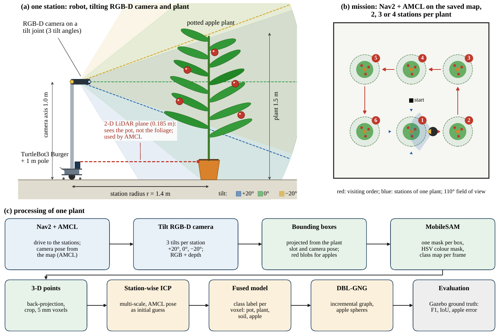
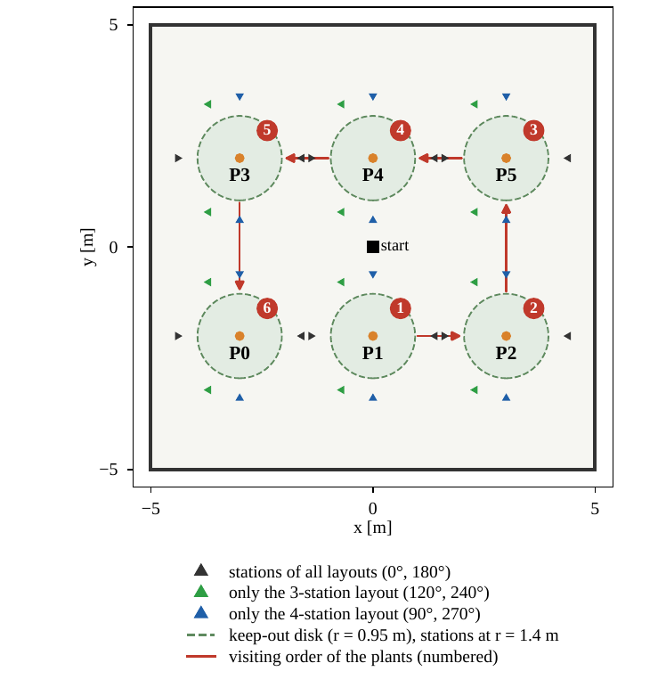
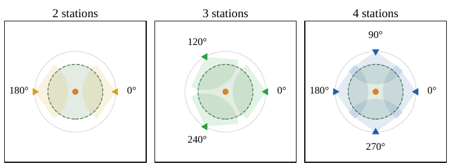
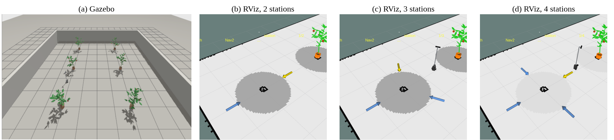
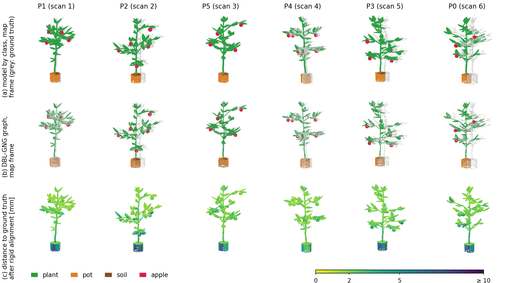

# Tutorial: scanning six plants from 2, 3 or 4 viewpoints

This tutorial takes you from a clean Ubuntu 22.04 machine to a finished mission in which a TurtleBot3 visits
the scan stations of six potted plants in Gazebo, takes images with a tilting RGB-D camera, and builds a MobileSAM-segmented
3-D model and a DBL-GNG graph of every plant, all visible live in Gazebo and RViz.

* [1. What happens in a mission](#1-what-happens-in-a-mission)
* [2. Requirements](#2-requirements)
* [3. Install the dependencies](#3-install-the-dependencies)
* [4. Get the code and build it](#4-get-the-code-and-build-it)
* [5. Get the MobileSAM weights](#5-get-the-mobilesam-weights)
* [6. The environment file](#6-the-environment-file)
* [7. Check the installation](#7-check-the-installation)
* [8. The scan geometry](#8-the-scan-geometry)
* [9. Run a mission](#9-run-a-mission)
* [10. The output files](#10-the-output-files)
* [11. How the results are scored](#11-how-the-results-are-scored)
* [12. Launch arguments](#12-launch-arguments)
* [13. Variations](#13-variations)
* [14. Running MobileSAM on the CPU](#14-running-mobilesam-on-the-cpu)
* [15. Troubleshooting](#15-troubleshooting)
* [16. Where things are in the code](#16-where-things-are-in-the-code)
* [17. What would change on a real robot](#17-what-would-change-on-a-real-robot)

---

## 1. What happens in a mission

<p align="center"></p>

1. **Gazebo** starts the 10 × 10 m arena with six potted plants and a TurtleBot3 Burger that carries a 1 m pole with a
   tilting RGB-D camera at the top. The robot spawns at the map origin (0, 0).
2. **Nav2 + AMCL** start on a saved 2-D occupancy map. AMCL begins at the known spawn pose, so no "2D Pose Estimate"
   is needed.
3. The **scan manager** (`scan_manager.py`) drives the robot with Nav2 to the stations around plant 1, then 2, 5, 4, 3, 0.
   At every station the robot stands still and the camera takes a frame at each of three tilt angles (+20°, 0°, −20°).
4. For every frame the code builds **bounding boxes** of the plant, the pot, the soil and the apples, lets **MobileSAM**
   cut one mask per box, cleans the masks with an HSV colour test, back-projects the masked depth pixels into a
   class-labelled point cloud in the map frame, registers it to the model built so far with a multi-scale ICP, and
   updates an incremental **DBL-GNG** graph.
5. After the last view of a plant the model is **scored against the exact ground truth** of the simulator, and the
   robot continues to the next plant. Results are saved to `~/plant_ws/results/scan_<date>_<time>/`.

The only thing that differs between the 2-, 3- and 4-viewpoint missions is the set of stations around each plant.

---

## 2. Requirements

**Tested configuration** (everything in this tutorial was verified on it):

| Item | Version |
|---|---|
| OS | Ubuntu 22.04.5 LTS |
| ROS 2 | Humble (Nav2 1.1.20, ros_gz 0.244.x) |
| Simulator | Gazebo Fortress 6.18 (`ign gazebo`) |
| Python | 3.10.12 |
| PyTorch / Ultralytics | 2.13.0 / 8.4.128 (MobileSAM is run through Ultralytics) |
| Open3D, NumPy, SciPy, OpenCV | 0.19.0, 1.26.4, 1.8.0, 4.9.0 |
| CPU / RAM / GPU | Intel Core i9-11980HK, 31 GB, NVIDIA RTX 3080 Laptop GPU with 8 GB (driver 595) |

* An **NVIDIA GPU with CUDA** is needed for the missions as shipped (MobileSAM is created on GPU 0). With 8 GB it ran
  next to the Gazebo window and RViz. See [section 14](#14-running-mobilesam-on-the-cpu) for the CPU change.
* Other versions and other hardware were not tested.
* The simulation is isolated from other ROS 2 / Gazebo sessions on your network (see [section 6](#6-the-environment-file)).

---

## 3. Install the dependencies

### 3.1 ROS 2 Humble, Nav2, Gazebo Fortress

Install ROS 2 Humble by following the [official instructions](https://docs.ros.org/en/humble/Installation/Ubuntu-Install-Debs.html),
then:

```bash
sudo apt update
sudo apt install ros-humble-desktop ros-humble-navigation2 ros-humble-nav2-bringup \
  ros-humble-nav2-simple-commander ros-humble-ros-gz ros-humble-xacro ros-humble-twist-mux \
  ros-humble-slam-toolbox python3-colcon-common-extensions python3-pip \
  python3-scipy python3-matplotlib python3-yaml
```

`ros-humble-ros-gz` depends on Gazebo Fortress (`libignition-gazebo6`), so it installs the simulator. Check:

```bash
ign gazebo --versions        # prints 6.x.y
```

(`ros-humble-slam-toolbox` is only used to re-make the 2-D map, see [MAPPING.md](MAPPING.md).)

### 3.2 Python packages

`plant_recon` needs NumPy, SciPy, OpenCV, Open3D and Ultralytics (with PyTorch). **Install NumPy 1.x first and keep it**:
ROS 2 Humble's Python packages are built against NumPy 1.x, and a fresh `pip install ultralytics` may otherwise pull
in NumPy 2.

```bash
pip3 install --user "numpy==1.26.4"
pip3 install --user -r ~/plant_ws/requirements.txt      # after step 4; or install the packages listed in it by hand
python3 -c "import numpy; print(numpy.__version__)"     # must still print 1.26.4
python3 -c "import torch; print(torch.cuda.is_available())"   # True for the GPU missions
```

SciPy 1.8 (from apt) prints a harmless version warning with NumPy 1.26.

---

## 4. Get the code and build it

The scripts assume the workspace is at **`~/plant_ws`**.

```bash
git clone https://github.com/yani-rl-ai/plant-recon-viewpoints.git ~/plant_ws
cd ~/plant_ws
source /opt/ros/humble/setup.bash
colcon build --symlink-install --packages-select plant_sim
```

* `plant_sim` is the only colcon package. `plant_recon` is plain Python and is found by path.
* Keep `--symlink-install`: the scan manager finds `plant_recon` through the symlink that leads from `install/` back
  to `src/`.
* The scripts in `src/plant_sim/scripts` must be executable *before* you build. Git keeps the executable bit, so a
  normal clone is fine; if `ros2 launch` later says "executable not found", run
  `chmod +x ~/plant_ws/src/plant_sim/scripts/*.py` and build again.

Run the unit tests of the reconstruction code (DBL-GNG and the metrics):

```bash
cd ~/plant_ws && python3 -m pytest src/plant_recon/tests -q        # 24 passed
```

---

## 5. Get the MobileSAM weights

The weights are not stored in the repository (40 MB). The code expects `~/plant_ws/models/mobile_sam.pt`:

```bash
mkdir -p ~/plant_ws/models
wget -O ~/plant_ws/models/mobile_sam.pt https://github.com/ultralytics/assets/releases/download/v8.2.0/mobile_sam.pt
sha256sum ~/plant_ws/models/mobile_sam.pt
# 6dbb90523a35330fedd7f1d3dfc66f995213d81b29a5ca8108dbcdd4e37d6c2f  (40,728,226 bytes)
```

Check the licence terms of the weights in the MobileSAM project before redistributing them. Another location can be
given with the scan manager's `--sam` option.

---

## 6. The environment file

```bash
source ~/plant_ws/env.sh
```

Run this in **every terminal** you use for the project. It sets `ROS_DOMAIN_ID=42`, `ROS_LOCALHOST_ONLY=1` and
`IGN_PARTITION=plant_sim` (own Gazebo transport partition), sources ROS 2 Humble and, if it exists, this workspace's
`install/setup.bash`. The isolation keeps the simulation away from other ROS 2 or Gazebo sessions on the same network
(a foreign Gazebo simulation on a LAN can otherwise pollute the topics).

A terminal without `env.sh` will not see the robot's topics. This is the most common mistake.

To stop everything that belongs to the simulation:

```bash
~/plant_ws/stop_sim.sh
```

It only kills processes that carry `IGN_PARTITION=plant_*` in their environment (Gazebo, the bridge, Nav2, RViz of
this project, the scan manager), so your other ROS 2 sessions are left alone. Do not use `pkill -f` with a pattern that
also occurs in your own shell's command line: it kills your shell.

---

## 7. Check the installation

### 7.1 Self-test of the simulation (headless, about 1 minute)

Terminal A:

```bash
source ~/plant_ws/env.sh
ros2 launch plant_sim sim.launch.py headless:=true rviz:=false
```

Terminal B, after about 20 s:

```bash
source ~/plant_ws/env.sh
python3 ~/plant_ws/src/plant_sim/scripts/check_sim.py --out /tmp/plant_check --drive
```

It checks the camera (640 × 360, 110° field of view, height 1.000 m), the 270° laser (scan plane 0.185 m above the
floor, so it hits the pots but not the foliage), the point cloud, the tilt motor and driving stability. It ends with

```
RESULT: ALL PASS
```

and exit code 0. Stop the simulation with `~/plant_ws/stop_sim.sh`.

### 7.2 Navigation

```bash
source ~/plant_ws/env.sh
ros2 launch plant_sim nav.launch.py
```

Gazebo and RViz open. In the terminal you should see, after roughly 10 s,

```
[nav2_bringup]: NAV2 READY: all 8 nodes active after 10.5 s
```

In the first seconds Nav2's costmap may log "Timed out waiting for transform from base_link to odom". This is normal
while Gazebo spawns the robot and goes away once Nav2 is ready.

You can send a goal with RViz's "Nav2 Goal" tool, or drive by hand in another terminal:

```bash
source ~/plant_ws/env.sh
ros2 run plant_sim teleop_keyboard.py          # w/x forward/back, a/d turn, s stop, r/f camera tilt down/up, q quit
```

Keyboard commands override Nav2 while you hold a speed. Stop with `~/plant_ws/stop_sim.sh`.

---

## 8. The scan geometry

<p align="center"></p>

| Plant | P0 | P1 | P2 | P3 | P4 | P5 |
|---|---|---|---|---|---|---|
| Position (x, y) [m] | (−3, −2) | (0, −2) | (3, −2) | (−3, 2) | (0, 2) | (3, 2) |

* The arena is 10 × 10 m, the robot starts at the origin. Plants are visited in the order **1, 2, 5, 4, 3, 0**
  (the `plants:=` argument).
* **Stations** lie on a circle of radius **1.4 m** around a plant and face it. Their azimuths (degrees, counter-clockwise
  from the map's +x axis) are given by `azimuths:=`:
  * `0,180`: 2 viewpoints; `0,120,240`: 3 viewpoints; `0,90,180,270`: 4 viewpoints.
  * The stations are nested: 0° and 180° belong to every layout, 120° and 240° only to the 3-viewpoint layout, 90° and
    270° only to the 4-viewpoint layout.
* At every station the camera takes three frames at tilts **+20°, 0°, −20°** (`tilts:=0.35,0.0,-0.35`, in radians; a
  positive tilt looks **down**). The camera axis is 1.0 m above the floor.
* A **keep-out disc** of radius 0.95 m around every plant is added to Nav2's costmaps, so the robot never enters a
  canopy. The stations are 0.45 m outside the disc.
* The robot visits the stations of a plant **counter-clockwise, starting with the one nearest to it**. Between two
  stations it follows the circle in hops of at most 90°, because with only two stations on opposite sides of a plant
  the two ways round are a tie for the planner.
* A station counts as **reached** when the robot's map pose is within 0.6 m and 0.6 rad of it.
  The goal is attempted up to 3 times (timeout 180 s each).
* Before each goal the robot turns in place towards the path if its heading is more than 45° off the first path segment
  (`nav_helpers.py`), because Nav2's DWB controller can otherwise stand still. A watchdog cancels a goal when the robot
  moved less than 0.12 m in 25 s and retries.
* The 0° stations of plants 2 and 5 and the 180° stations of plants 0 and 3 are about 0.6 m from the arena wall.

<p align="center"></p>

---

## 9. Run a mission

Open a terminal, then:

```bash
source ~/plant_ws/env.sh

# 2 viewpoints
ros2 launch plant_sim scan.launch.py plants:=1,2,5,4,3,0 pose_source:=map use_yolo:=false localizer:=amcl azimuths:=0,180

# or 3 viewpoints
ros2 launch plant_sim scan.launch.py plants:=1,2,5,4,3,0 pose_source:=map use_yolo:=false localizer:=amcl azimuths:=0,120,240

# or 4 viewpoints
ros2 launch plant_sim scan.launch.py plants:=1,2,5,4,3,0 pose_source:=map use_yolo:=false localizer:=amcl azimuths:=0,90,180,270
```

| Argument | Why |
|---|---|
| `pose_source:=map` | **Use the AMCL pose on the map as the camera pose.** The default `odom` uses wheel odometry only; it drifted to more than 1 m in a full mission. |
| `use_yolo:=false` | MobileSAM gets only the boxes computed from geometry and colour. No detector is used. |
| `localizer:=amcl` | Accepted for command-line compatibility. AMCL is the only localiser in this repository. |
| `azimuths:=...` | The viewpoints, see section 8. |

### 9.1 Timeline

| Time (4 viewpoints) | What happens |
|---|---|
| 0 – 10 s | Gazebo and RViz open; Nav2 and AMCL start; the scan manager prints `waiting for Nav2 (AMCL + bt_navigator) ...` |
| ~10 s | `NAV2 READY`; the manager waits for camera images, ground-truth poses and TF, then drives to plant 1 |
| per station | drive (with a turn in place first if needed), wait until the robot is still, then three tilts |
| per view | MobileSAM ≈ 0.2 s; registration and DBL-GNG update 2–4 s (grows with the model) |
| per plant | 105 s (2 viewpoints), 148 s (3), 190 s (4) typical; a final DBL-GNG fit and the metrics are computed at the end |
| end | `ALL DONE (6 plants, 21.4 min)` for 4 viewpoints, 14.7 min for 3, 10.3 min for 2 |

Do **not** close the Gazebo window during a mission: it stops the whole launch. Do not use the teleop at the same time;
it overrides Nav2.

### 9.2 What RViz shows (`config/plant_scan.rviz`)

<p align="center"></p>

* the 2-D map, the **keep-out zones** (grey discs), the robot model and the laser scan;
* the **scan stations** as arrows: **yellow = the station being visited, blue = the others**;
* the **model of finished plants** and the **reconstruction of the current plant**, in camera colour and by class
  (green plant, orange pot, brown soil, red apple);
* the **DBL-GNG graph** (nodes and edges);
* **apples**: ground truth (green) against the estimate (red);
* a **status text** that tells what the robot is doing and, after every plant, its scores;
* the **MobileSAM class map** of the current frame as an image.

### 9.3 The terminal output

Progress messages (the numbers below are from a real 4-viewpoint mission):

```
[scan_manager]: waiting for Nav2 (AMCL + bt_navigator) ...
[scan_manager]: plant 1   station 1/4 (90 deg) | driving with Nav2 ...
[scan_manager]: pre-rotation: path heading was -90 deg off, now -3 deg
[scan_manager]: plant 1   station 1/4   tilt +20 deg | segmenting + reconstructing ...
[scan_manager]:   view  1 st1 tilt  +20: seg IoU 0.97 | pts  5685 -> model   5685 | icp - | GNG  400 nodes | F1@1cm 0.238 (obs 0.275) F1@2cm 0.588 | shape-aligned F1@1cm 0.718 F1@2cm 0.857 | cam-pose err 25 mm 0.79 deg | 7.2 s
...
[scan_manager]: plant 1 DONE (210 s) | F1@1cm 0.32  F1@2cm 0.69   per class @2cm: pot 0.93 plant 1.00 apple 1.00 soil 0.98 | voxel IoU@2cm (aligned): cloud 0.82  dbl_gng 0.31 | apples 4/4 localised (DBL-GNG), mean err 0.6 mm
...
[scan_manager]: ALL DONE (6 plants, 21.4 min) | results: /home/<you>/plant_ws/results/scan_<date>_<time>
```

How to read a `view` line:

* `seg IoU`: overlap of the MobileSAM mask with the ground-truth mask of the plant;
* `pts 5685 -> model 5685`: points of this view, and points in the fused model afterwards;
* `icp`: `-` = first view of a plant (nothing to register to), `ON` = an ICP correction was accepted, `off` = not applied;
* `F1@1cm / F1@2cm`: against the ground truth **in the frame in which the model is built** (for `pose_source:=map`
  this is the map frame, so it contains the camera-pose error; the status text still calls it "odom frame (with drift)"
  for historical reasons);
* `shape-aligned`: the same after the best rigid alignment to the true surface;
* `cam-pose err`: AMCL camera pose against Gazebo's true pose.

On the `DONE` line the two F1 values are in the model frame, while "per class", "voxel IoU" and the apple result are in
the aligned frame (section 11). When the mission ends the manager keeps RViz alive; press Ctrl+C to quit, then
`~/plant_ws/stop_sim.sh`.

---

## 10. The output files

```
~/plant_ws/results/scan_20261115_205353/
├── args.json              the arguments of the run
├── summary.md             one table per run: F1, GNG, apples, seconds per plant, mission time; voxel IoU table
├── summary.json           the same as JSON
└── plant1/                one folder per plant (plant0 ... plant5)
    ├── metrics.json       all scores of the plant and one entry per view ("views_log")
    ├── model.npz          the fused point cloud: P (n×3 points, map frame), C (n×3 colours), L (n labels)
    ├── graph.npz          the DBL-GNG graph: nodes (m×3), edges (k×2), components (m), node_class (m)
    └── view_01.npz ...    every recorded frame, so a run can be replayed
```

Class labels in `L` and `node_class`: **1 pot, 2 plant (stem and leaves), 3 apple, 4 soil**.

Each `view_XX.npz` holds the colour image (`color`), the depth image (`depth`), the intrinsics (`K`), the camera poses
(`T_map_opt` from AMCL, `T_odom_opt`, `T_odom_map`, and the true pose `T_gt_opt`), the tilt, the station index, the plant
slot (`prior`) and the plant id.

View a reconstruction in 3-D (Open3D window; drag to rotate):

```python
import numpy as np, open3d as o3d
m = np.load('plant1/model.npz')                                   # run inside a results folder
colour = {1: (0.85, 0.51, 0.17), 2: (0.18, 0.62, 0.27), 3: (0.84, 0.13, 0.29), 4: (0.48, 0.32, 0.19)}
rgb = np.array([colour.get(int(l), (0.5, 0.5, 0.5)) for l in m['L']])
pcd = o3d.geometry.PointCloud()
pcd.points = o3d.utility.Vector3dVector(m['P'])
pcd.colors = o3d.utility.Vector3dVector(rgb)
o3d.visualization.draw_geometries([pcd])
```

Example reconstructions of the six plants from a 4-viewpoint mission (row a: model by class over the ground truth in grey;
row b: DBL-GNG graph; row c: distance to the true surface after alignment):

<p align="center"></p>

---

## 11. How the results are scored

The ground truth comes from the simulator and is used **only for the scores**, never by the reconstruction (the
reconstruction does use the known plant slot positions to place its bounding boxes):

* **Surface:** `src/plant_sim/scripts/gen_world.py` builds every plant from primitives (cylinders, spheres, one leaf mesh)
  and samples the same primitives analytically with 1.5 × 10⁵ points per m² into `gt/plants_gt.npz`, with a class and a
  plant number per point. The surface is therefore exact, not scanned.
* **Apples:** centre and radius of every apple sphere (`gt/plants.json`).
* **Camera pose:** Gazebo's true pose of the robot and the tilt link, combined into the true pose of the camera.
* **Segmentation masks:** every depth pixel is back-projected with the true camera pose and receives the class and plant
  of the nearest ground-truth point within 2 cm.

Scores (`metrics.json`):

* **F1 at 1, 2 and 5 cm.** Precision is the share of model points within τ of the true surface, recall the share of the
  true surface within τ of the model, F1 their harmonic mean.
* **Two frames.** *Map* (`cloud`): the frame in which the model was built, containing the camera-pose error. *Aligned*
  (`cloud_aligned`): after the rigid transform that best maps the model onto the true surface; it measures the shape
  independent of placement and needs the ground truth. Per-class scores, graph scores and the standard apple matching
  use the aligned frame; apples are also scored in the map frame (`fruit_absolute`).
* **DBL-GNG graph** (`gng_incremental`): nodes, edges, connected components, distance of the nodes to the surface,
  quantisation error, share of the true surface within 2 cm of a node.
* **Apples:** spheres are fitted to groups of fruit nodes and matched to the true apples with the Hungarian algorithm
  (5 cm gate): matched, false positives, mean centre error.
* **Voxel IoU** (`shape_iou`) of the merged cloud and of the graph nodes, **mask IoU** per view and the **camera-pose
  error** per view (`views_log`).

**Interpretation notes.** The aligned-frame numbers are high for every layout (F1 @ 2 cm 0.98–1.00) and mostly show that
more viewpoints add coverage, notably of the pot and the apples. The map-frame F1 is low and does not follow the number
of viewpoints, because it is dominated by the AMCL pose error (median 68–83 mm over all views in the reference
missions). The `observable_gt_fraction` and `*_observed` entries use a definition that is **not** a coverage measure
(they count only ground-truth points that are the nearest hit of a depth pixel); prefer recall.

---

## 12. Launch arguments

`scan.launch.py` (everything of `nav.launch.py` and `sim.launch.py` is included):

| Argument | Default | Meaning |
|---|---|---|
| `plants` | `1,2,5,4,3,0` | plants to visit, in this order (ids 0–5) |
| `azimuths` | `0,90,180,270` | station azimuths around each plant [deg] |
| `radius` | `1.4` | station circle radius [m] |
| `tilts` | `0.35,0.0,-0.35` | camera tilt angles [rad]; positive = looking down |
| `pose_source` | `odom` | `map` = AMCL pose on the saved map (use this); `odom` = wheel odometry only |
| `seg` | `sam` | `sam` = MobileSAM; `color` = HSV rule only (baseline); `oracle` = ground-truth masks (upper bound) |
| `use_yolo` | `false` | `true` adds YOLO detections as extra boxes; needs `models/yolo26n-seg.pt`, which is not included |
| `localizer` | `amcl` | accepted for compatibility; AMCL is the only localiser |
| `headless` | `false` | `true` runs Gazebo without its window |
| `scan_rviz` | `true` | `false` does not open RViz |
| `domain`, `partition` | `42`, `plant_sim` | ROS domain and Gazebo partition (see section 15 for running two simulations) |

`nav.launch.py` adds `rviz` (default `true`), and `x`, `y`, `yaw` (spawn pose, default 0, 0, 0; the saved map assumes the
origin). `sim.launch.py` adds `map` (path of a map yaml; default `maps/plant_arena.yaml`).

Run a mission without any window (the self-tests in sections 7.1 and 7.2 were run headless; a complete headless mission was not part of the reference runs):

```bash
ros2 launch plant_sim scan.launch.py headless:=true scan_rviz:=false plants:=1 pose_source:=map use_yolo:=false azimuths:=0,180
```

---

## 13. Variations

* **One or a few plants** (a quick look takes a few minutes): `plants:=1` or `plants:=1,2`.
* **Other layouts:** any list of azimuths works in the code, for example `azimuths:=0,60,120,180,240,300`. Only the
  three layouts above were tested.
* **Radius and tilts:** `radius:=...`, `tilts:=...`. Only 1.4 m and ±20° were tested. A larger radius pushes the
  stations next to the walls (section 8) towards the wall, where they may become unreachable.
* **Segmentation baselines:** `seg:=color` and `seg:=oracle` exist for comparison; they were not part of the reference
  missions.
* **Different plants or positions:** edit and run `src/plant_sim/scripts/gen_world.py` (it rewrites the world, the
  ground truth and `plants.json`), rebuild, and make a new map ([MAPPING.md](MAPPING.md)) if the pots moved. The scan
  manager takes the plant slots from `gt/plants.json`, but its helper `check_localization.py` has them hard-coded.

---

## 14. Running MobileSAM on the CPU

As shipped, the scan manager creates MobileSAM on GPU 0. To use the CPU, change one line in
`src/plant_sim/scripts/scan_manager.py` (in `main()`), adding `device='cpu'`:

```python
yolo = SamSegmenter(args.sam, args.yolo if use_yolo else None, use_yolo_box=use_yolo, gate_colour=True, device='cpu') if args.seg == 'sam' else None
```

The constructor accepts `device`, and the offline scripts and figure code use `'cpu'`, where a frame takes well under a
second on the reference machine. A complete live mission on the CPU has **not** been tested.

---

## 15. Troubleshooting

| Symptom | Cause and fix |
|---|---|
| `ros2 topic list` shows no robot topics, teleop does nothing | `env.sh` was not sourced in that terminal (domain 42, loopback only). |
| `executable 'scan_manager.py' not found` | Scripts were not executable at build time: `chmod +x ~/plant_ws/src/plant_sim/scripts/*.py`, rebuild with `--symlink-install`. |
| `FileNotFoundError ... mobile_sam.pt` | Section 5, or give `--sam` to the scan manager. |
| `A module that was compiled using NumPy 1.x cannot be run in NumPy 2` | NumPy was upgraded by pip: `pip3 install --user "numpy==1.26.4"`. |
| `CUDA out of memory`, or MobileSAM very slow | Close other GPU programs; Gazebo's window, RViz and MobileSAM share the GPU. Or use the CPU (section 14). |
| `ModuleNotFoundError: plant_recon` | The workspace was built without `--symlink-install` and is not at `~/plant_ws`. Rebuild with `--symlink-install`, or set up the path. |
| Mission stays at `waiting for camera, ground-truth poses and TF ...` | The simulation is not running in the same domain, or Gazebo has not started. Wait up to a minute; otherwise `stop_sim.sh` and start again. |
| Old Gazebo / RViz / Nav2 processes are still around | `~/plant_ws/stop_sim.sh`. Do not use `pkill -f`. |
| Everything vanished at once | The Gazebo window was closed; this ends the whole launch. |
| Nav2 prints `Failed to make progress` and the robot spins or backs up | A Nav2 recovery. The manager retries a goal up to 3 times. In one 4-viewpoint mission this cost about 2.5 minutes at plant 5 and the mission still finished with all stations reached. |
| `Timed out waiting for transform from base_link to odom` in the first seconds | Normal while the robot spawns; stops once `NAV2 READY` appears. |
| Metrics in the map frame look poor (F1 @ 2 cm around 0.3) | Expected, see section 11: it is the AMCL pose error, not the reconstruction. Compare with the `shape-aligned` values. |
| Two simulations at the same time | Start the second with different `domain:=` and `partition:=`, e.g. `domain:=43 partition:=plant_test`, and export the same `ROS_DOMAIN_ID` and `IGN_PARTITION` in its other terminals instead of sourcing `env.sh`. `stop_sim.sh` stops **all** partitions named `plant_*`. |

---

## 16. Where things are in the code

| What | File |
|---|---|
| Stations, tilts, the loop over plants, logging, saving | `src/plant_sim/scripts/scan_manager.py` |
| Pre-rotation, arc hops, watchdog, retries | `src/plant_sim/scripts/nav_helpers.py` |
| Nav2, AMCL, costmaps, DWB parameters | `src/plant_sim/config/nav2_params.yaml` |
| Gazebo world, robot, bridge | `src/plant_sim/launch/sim.launch.py`, `urdf/`, `worlds/`, `config/bridge.yaml` |
| Bounding boxes, MobileSAM, colour mask | `src/plant_recon/plant_recon/segment.py` (`SamSegmenter`) |
| Depth to points, ground truth, poses | `src/plant_recon/plant_recon/geom.py` |
| Multi-scale ICP | `src/plant_recon/plant_recon/registration.py` |
| DBL-GNG | `src/plant_recon/plant_recon/dbl_gng.py` |
| Reconstruction of one plant (`PlantReconstructor`) and the scoring | `src/plant_recon/plant_recon/pipeline.py`, `recon_metrics.py` |

**How the bounding boxes are made** (`SamSegmenter.__call__`): the known plant slot is combined with the camera pose and
intrinsics. Rings of 3-D points around the slot (plant: four rings of radius 0.55 m at 0, 0.5, 1.0 and 1.55 m plus the
apex; pot: radius 0.11 m at 0 and 0.20 m; soil: radius 0.10 m at 0.203 m) are projected into the image and the box is
their minimum and maximum pixel (padding 6, 3 and 2 px). Apple boxes are the connected HSV-red regions (at least 6 px)
inside the plant box. All boxes go to MobileSAM in one call; the class of a mask is the class of its box; the plant and
apple masks are intersected with an HSV colour test, and overlaps are resolved with the priority apple > soil > pot > plant.

---

## 17. What would change on a real robot

Not tested, but these are the assumptions to revisit:

* **Ground truth.** There is none; the scores need a reference (a high-quality scan, caliper-measured apples, marker-based
  camera poses). The F1 values then measure agreement with the reference, not with an exact surface.
* **Plant positions.** The boxes use the known plant slots; they would have to be measured or detected.
* **Colours.** The HSV thresholds in `segment.py` are tuned for the simulated colours.
* **Depth.** The simulated depth has no noise model; real RGB-D depth has noise, bias and flying pixels.
* **Camera pose.** The pose chain (map → odom → base → tilt joint → camera) needs a calibrated extrinsic and tilt
  angle; a tilt error of 1° at 1.4 m already shifts a point by about 2.4 cm.
* **Localisation.** AMCL needs a map in which the laser sees stable structure; in the simulation the pots are on the
  map because the scan plane (0.185 m) cuts them.
